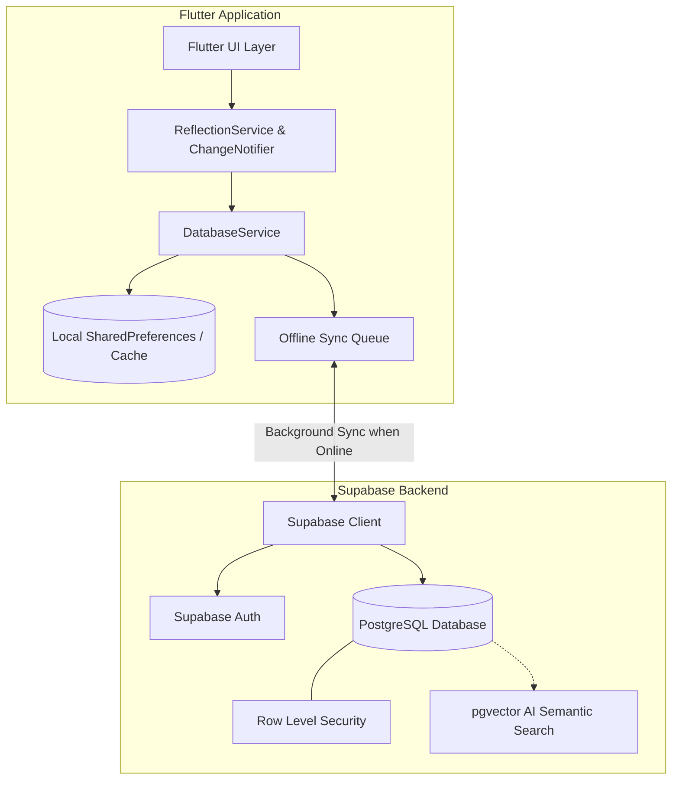

# Architecture Design - Daily Reflection

## Overview

**Daily Reflection** is a mindful daily journaling and self-reflection application built with a **Local-First, Cloud-Synced** architecture.

---

## Key Design Principles

### 1. Local-First & 0ms UI Latency
* All user reads, writes, bookmark updates, and deletions execute immediately on the local device storage.
* The UI never waits on network requests, ensuring a fast, flicker-free journaling experience.

### 2. Automatic Offline-to-Online Sync
* If the user creates or edits reflections while offline or in guest mode, actions are stored in a local pending queue.
* When network connectivity is active and the user is authenticated, `DatabaseService.syncPendingChanges()` flushes pending writes and merges remote reflections.

### 3. Graceful Local Guest Fallback
* Users can use the entire application immediately upon first launch without entering an email or creating an account.
* Guest sessions use private local IDs (`guest_...`), with zero network hurdles or blocking modals.

### 4. Privacy & Row Level Security
* On Supabase PostgreSQL, strict Row Level Security (RLS) guarantees that users can only query and mutate records where `user_id == auth.uid()`.
